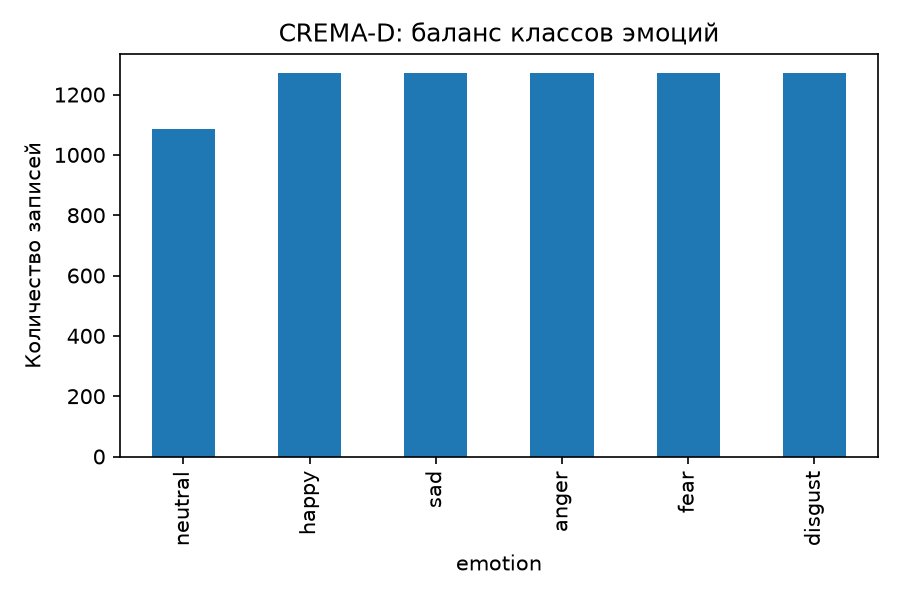
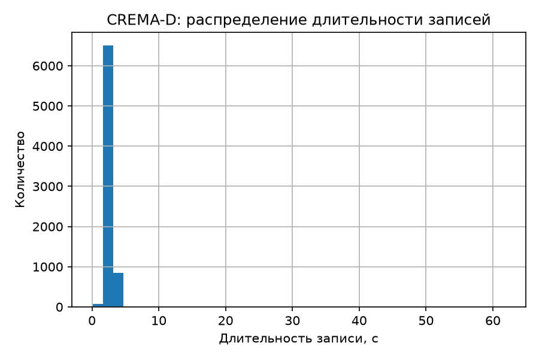
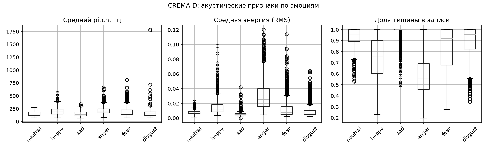
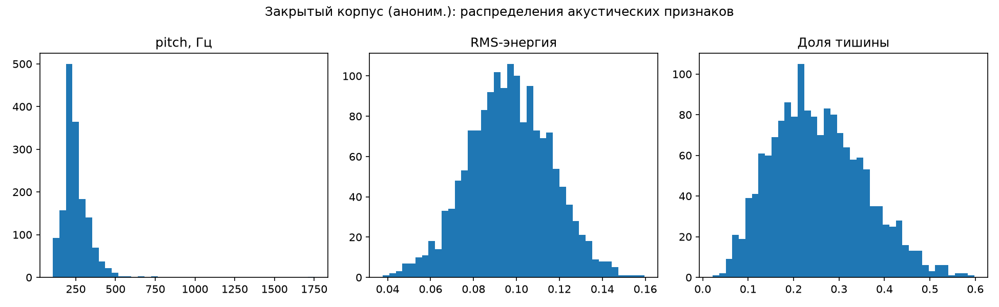
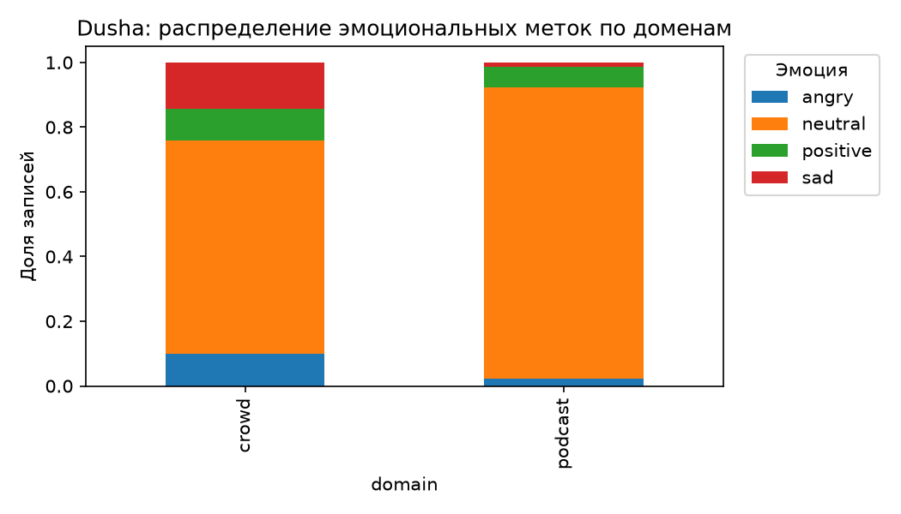
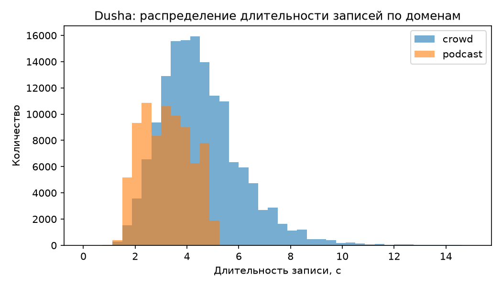
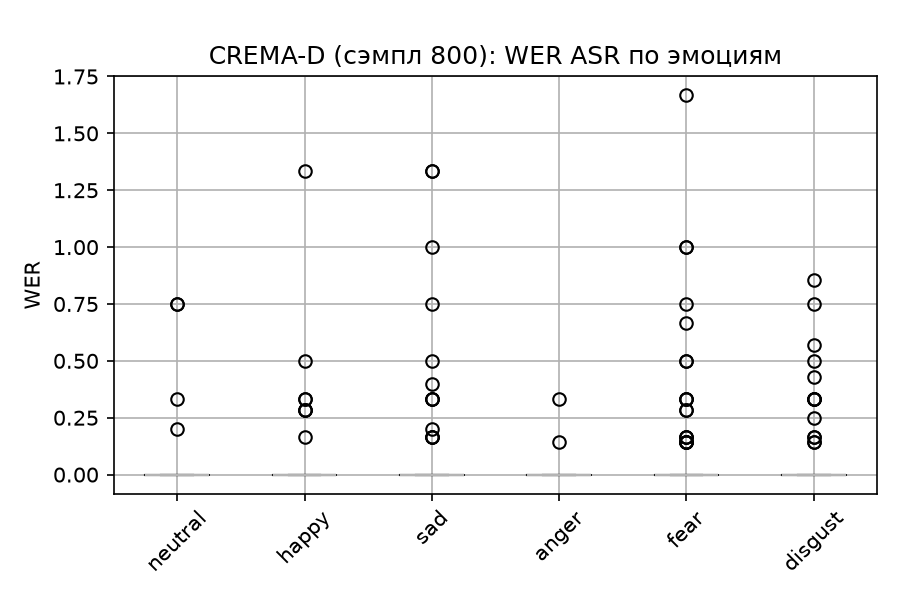

# EDA отчёт, ДЗ №2

Разведочный анализ данных для MVP Acoustic Stress & Emotion Monitor.
Реальные записи звонков закрыты NDA, поэтому анализ ведётся на
открытых прокси-датасетах эмоциональной речи.

Скрипты анализа (читают уже посчитанные данные и строят графики):

- `scripts/eda_crema.py` - акустика CREMA-D
- `scripts/eda_dusha.py` - метаданные Dusha
- `scripts/eda_asr.py` - результаты ASR-транскрипции

Скрипты подготовки признаков (запускаются на локальном чек-ауте
CREMA-D, см. docstring каждого файла):

- `scripts/extract_crema_acoustic_features.py`
- `scripts/transcribe_crema_sample.py`

Исходные данные лежат в `data/` (не коммитятся, см. `.gitignore`),
результаты - в `reports/eda_hw2/`.

## 1. Источники данных

| Датасет | Роль | Объём | Язык/тип речи | Что получили |
|---|---|---|---|---|
| CREMA-D | аудиоканал (акустика + эмоции) + текстовый канал (ASR) | 7442 клипа, 91 актёр | английский, акцентированная (зачитанная) речь, 12 фиксированных фраз | полный набор акустических признаков по всем клипам + ASR-транскрипты на сэмпле |
| Dusha | сравнение с разговорной речью (только метаданные, без аудио) | ~226 тыс. записей (crowd + podcast) | русский, голосовой ассистент (crowd) и спонтанная подкаст-речь (podcast) | распределение эмоциональных меток и длительностей по доменам |
| Закрытый корпус (анонимизированно) | сверка акустики на реальной русской речи, без транскриптов и меток | 1586 аудиочанков, ~3,6 часа | русский, реальные рабочие диалоги | только агрегированная статистика акустических признаков (раздел 3) |

CREMA-D и Dusha выбраны как открытые прокси вместо недоступных реальных
записей. Дополнительно акустику сверили на закрытом корпусе реальной
русской речи - без раскрытия источника, транскриптов и меток (раздел
3) - результат учтён в выводах ниже и в дизайн-документе.

## 2. CREMA-D: акустический канал

Акустические признаки (pitch, RMS-энергия, zero-crossing rate, доля
тишины, доля voiced-сегментов) посчитаны по всем 7442 файлам из видео
(FLV) через `ffmpeg` + `librosa` (`pyin` для pitch).

**Баланс классов.** 6 эмоций, явный лёгкий дисбаланс: `neutral` - 1087
записей, остальные 5 эмоций - по 1271. Для MVP-классификатора это
приемлемо, но для продакшена нужно либо дополнительно взвешивать класс
`neutral`, либо балансировать сэмплирование.

**Длительность.** Средняя 2,5-2,9 с по эмоциям, медиана около 2,5 с,
есть редкие выбросы до ~60 с (видео без обрезки пауз) - на этапе
препроцессинга нужна отдельная проверка на аномально длинные клипы.

**Акустика по эмоциям** (данные - `crema_summary_by_emotion.csv`):

| Эмоция | pitch, Гц (сред.) | RMS-энергия (сред.) | доля тишины (сред.) |
|---|---|---|---|
| neutral | 150 | 0.0077 | 0.93 |
| sad | 149 | 0.0055 | 0.97 |
| disgust | 160 | 0.0092 | 0.89 |
| fear | 197 | 0.0132 | 0.83 |
| happy | 200 | 0.0153 | 0.75 |
| anger | 213 | 0.0310 | 0.58 |

Чёткое разделение по возбуждению (arousal): `anger`/`happy`/`fear` -
высокий pitch и энергия, низкая доля пауз; `sad`/`neutral` - низкий
pitch и энергия, много тишины. Это ожидаемая связь эмоционального
возбуждения с акустикой речи, и она подтверждает, что выбранный набор
признаков (пункт 2.1 дизайн-документа) несёт сигнал уже на уровне
простой описательной статистики, без обучения модели.

**Пропуски pitch.** На 232 из 7442 файлов (3,1%) не нашлось voiced-
сегментов (pyin не определил f0) - в основном очень короткие или тихие
клипы. Для прод-пайплайна - явный QC-статус вместо нулевого
значения (уже заложено как риск в разделе 2.3 дизайн-документа).

## 3. Сверка акустики на закрытых данных (анонимизированно)

В дополнение к открытым прокси акустические признаки (pitch, RMS-
энергия, доля тишины) посчитаны тем же методом, что и для CREMA-D, на
закрытом корпусе реальной русской разговорной речи. Наружу выгружена
только агрегированная статистика и график распределений - без путей,
имён файлов, транскриптов или меток. Эмоциональных меток у этого
корпуса для EDA не использовали, поэтому сравнение ниже - по общей
акустике, а не по эмоциям. Скрипт -
`scripts/extract_closed_speech_acoustic_summary.py`, данные -
`closed_corpus_acoustic_summary.json`.

| Признак | Закрытый корпус (n=1586) | CREMA-D (диапазон по эмоциям) |
|---|---|---|
| Длительность, с | 8,1 (медиана 8,4) | 2,5-2,9 |
| pitch, Гц | 250 (медиана 233) | 149-213 |
| RMS-энергия | 0,097 | 0,0055-0,031 |
| Доля тишины | 0,25 | 0,58-0,97 |

**Что сопоставимо.** Чанки закрытого корпуса примерно втрое длиннее
клипов CREMA-D и заметно менее «тихие» - ожидаемо: это уже нарезанные
VAD'ом (voice activity detection - детектором речевой активности)
фрагменты живого диалога, а не изолированные короткие фразы с паузой
до и после записи.

**Что нужно интерпретировать осторожно.** Абсолютные значения pitch и
RMS-энергии напрямую не сравнимы между корпусами: разная аппаратура
записи, разный канал (студийная запись у CREMA-D против рабочей линии
в закрытом корпусе) и разный гендерный состав дикторов сами по себе
сдвигают эти величины. Поэтому из сравнения мы берём не абсолютные
цифры, а два качественных вывода:

1. Реальная рабочая речь кардинально отличается по форме записи
   (длина сегмента, доля пауз) от изолированных акцентированных
   клипов CREMA-D - подтверждает риск «домен открытых датасетов
   отличается от целевого», уже отмеченный в дизайн-документе.
2. Акустический пайплайн (`ffmpeg` + `librosa` + `pyin`) одинаково
   стабильно отрабатывает и на студийных клипах, и на реальных
   рабочих записях - это снижает риск, что baseline-признаки
   технически не заработают на целевом домене.

## 4. Dusha: сравнение с разговорной речью (метаданные)

**Распределение эмоций по доменам:**

| Домен | neutral | sad | angry | positive |
|---|---|---|---|---|
| crowd (команды ассистенту) | 66% | 14% | 10% | 10% |
| podcast (спонтанная речь) | 90% | 1% | 2% | 7% |

**Длительность.** crowd - в среднем 4,5 с (± 1,6), podcast - 3,2 с
(± 0,9).

**Вывод, важный для раздела рисков дизайн-документа.** Домен,
максимально близкий по характеру к рабочему диалогу (podcast,
неразмеченная спонтанная речь, а не команды ассистенту), даёт 90%
нейтральных меток - в разы выше, чем в CREMA-D (где по конструкции
датасета ровно 1/6 на эмоцию) и выше, чем даже в crowd-домене Dusha.
Это согласуется с тем, что было видно на закрытых данных (без
деталей): реальная рабочая речь по умолчанию низкоэмоциональна, и
модель/агрегация должны быть рассчитаны на сильный дисбаланс классов и
слабый, но стабильный сигнал, а не на выраженные редкие эмоции.

## 5. Текстовый канал: ASR на CREMA-D

Транскрипция случайного сэмпла из 800 клипов CREMA-D (`faster-whisper
base.en`, CPU), сравнение с 12 эталонными фразами датасета по метрике
WER (word error rate - доля ошибочных слов в транскрипте) после
нормализации пунктуации и чисел. Скрипт -
`scripts/transcribe_crema_sample.py`, данные - `crema_asr_wer_by_emotion.csv`.

**Ограничение: анализ сделан на английской речи.** WER посчитан на
CREMA-D, потому что только там среди открытых данных есть эталонные
фразы, без которых WER не посчитать. Открытого датасета русской
эмоциональной речи с эталонными транскриптами мы не нашли, а из
закрытых данных для текстового канала взяли только акустику, без
транскриптов и меток (раздел 3) - прямого русскоязычного ASR-
бенчмарка по эмоциям здесь нет. До проверки на реальном русскоязычном
материале деградацию ASR на эмоционально окрашенной речи (ниже)
стоит считать языконезависимым паттерном, а не фактом про русскую
речь конкретно - это открытый вопрос для следующих итераций.

| Эмоция | WER (сред.) | WER (std) | n |
|---|---|---|---|
| anger | 0.003 | 0.031 | 138 |
| neutral | 0.018 | 0.104 | 115 |
| happy | 0.029 | 0.142 | 121 |
| disgust | 0.037 | 0.131 | 144 |
| sad | 0.052 | 0.205 | 135 |
| fear | 0.060 | 0.210 | 147 |

Средний WER по сэмплу - 0,034 (ASR в целом справляется хорошо), но
разброс по эмоциям велик: `anger` транскрибируется почти без ошибок
(резкая, чётко артикулированная речь), а `fear` и `sad` дают WER в
15-20 раз выше - смазанная/тихая/дрожащая речь мешает распознаванию.

**Whisper иногда галлюцинирует.** В худших случаях модель выдаёт
правдоподобный, но полностью не связанный с фразой текст. На клипе с
`fear`-прочтением фразы “It’s eleven o’clock” модель выдала “So what
in the fuck?” (WER 1,67). Для текстового канала это риск иного рода,
чем «шумный сигнал»: такая галлюцинация способна сама нести ложную
эмоциональную окраску и исказить вывод классификатора.

### Выводы для дизайн-документа

- Качество ASR существенно варьируется по эмоциям и ожидаемо хуже
  именно на тех классах (`fear`, `sad`), которые наиболее релевантны
  для задачи выявления стресса - то есть деградация текстового канала
  концентрируется там, где он нужнее всего.
- Единичные, но выраженные галлюцинации ASR на эмоционально
  искажённой речи - отдельный риск: нужен базовый sanity-фильтр
  транскрипта (например, по confidence/длине или сверке с ASR на
  альтернативной модели) до того, как текст уходит в классификатор
  эмоций по тексту.

## 6. Итоговые риски и выводы для дизайн-документа

1. Сильный дисбаланс в сторону `neutral`/низкой активации ожидается на
   реальных данных (подтверждено и на открытых прокси, и на закрытых
   данных без раскрытия деталей) - нужна метрика, устойчивая к
   дисбалансу (macro-F1 / balanced accuracy, а не accuracy), и
   калибровка baseline-агрегации с учётом этого сдвига.
2. Акустические признаки несут сигнал по эмоциям уже на уровне
   описательной статистики - подтверждает выбор признаков для
   baseline, но абсолютные пороги (например, порог тишины) нужно
   откалибровать на реальном домене, а не переносить с CREMA-D.
3. Домен открытых датасетов (акцентированная зачитанная английская
   речь / команды голосовому ассистенту) отличается от домена
   реальных рабочих диалогов - явное ограничение MVP, уже
   зафиксированное в разделе 2.1 дизайн-документа. Сверка акустики на
   закрытом корпусе реальной русской речи (раздел 3) подтверждает
   разрыв по форме записи (длина сегмента, доля пауз).
4. Качество ASR деградирует именно на эмоционально выраженной речи
   (`fear`/`sad` - WER на порядок выше, чем на `anger`/`neutral`). В
   худших случаях модель галлюцинирует: выдаёт правдоподобный, но не
   связанный с исходной фразой текст. Нужен sanity-фильтр транскрипта
   перед текстовым каналом эмоций.
5. ~3% клипов без определённого pitch и редкие клипы-выбросы по
   длительности - нужен QC-статус на этапе подготовки данных вместо
   отбрасывания или нулевых значений.
6. ASR-анализ (раздел 5) сделан на английской речи - открытого
   русскоязычного датасета с эталонными транскриптами для расчёта WER
   не нашлось, а из закрытых данных для текстового канала брали
   только акустику. Деградацию ASR на эмоциональной речи пока стоит
   считать языконезависимой гипотезой, а не проверенным фактом про
   русскую речь - нужна отдельная проверка на реальном материале.
