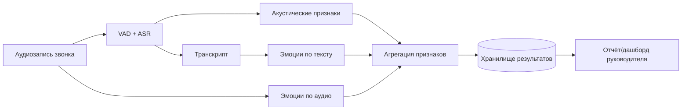

# Дизайн ML системы - Acoustic Stress & Emotion Monitor, MVP, v1

> Документ построен по шаблону [ML System Design Doc (Reliable ML)](https://github.com/IrinaGoloshchapova/ml_system_design_doc_ru/blob/main/ML_System_Design_Doc_Template.md).
>
> **Примечание о характере проекта.** Задача вдохновлена реальным
> классом прикладных систем (мониторинг психоэмоционального состояния
> сотрудников по аудиозаписям рабочих звонков), проект сейчас разрабатывается
> для реального заказчика и готовится к пилотированию.
>
> Название организации-заказчика, конкретные проприетарные
> модели, алгоритм интегральной оценка и проприетарные датасеты реальной
> системы защищены NDA и недоступны - в этом документе и в коде они
> заменены на нейтральные формулировки, открытые аналоги и
> baseline-заглушки (константы/простые эвристики) с явной пометкой
> каждого такого места.

## 1. Цели и предпосылки

### 1.1 Зачем идём в разработку продукта?

- **Бизнес-цель (PO).** Дать руководителю линии поддержки и HR
  систему поддержки принятия решений (СППР): инструмент раннего
  выявления повышенного стресса и выраженных негативных эмоций у
  сотрудников по записям их рабочих звонков, с отслеживанием динамики
  по каждому сотруднику во времени вместо разовой оценки одного
  звонка, чтобы вовремя скорректировать нагрузку, предложить
  короткий отдых или дополнительное обучение, не дожидаясь жалоб
  клиентов или явного снижения качества работы. Решение по сотруднику
  всегда принимает человек, система только даёт сигнал для внимания.
- **Почему ML улучшает ситуацию (PO и DS).** Прослушивание и ручная
  оценка всех звонков не масштабируется даже на небольшую команду.
  ML-модели позволяют автоматически извлекать акустические и
  текстовые признаки эмоционального состояния по каждому звонку и
  агрегировать их в компактный, сопоставимый между сотрудниками сигнал.
- **Критерии успеха итерации (PO).** Для тестового набора звонков
  пайплайн стабильно считает акустические признаки, эмоции по
  аудио/тексту и формирует агрегированный отчёт по звонку. На выборке
  с ручной экспертной разметкой агрегированная оценка качественно
  согласуется с отмеченными случаями явного стресса (без строгого
  количественного порога - он фиксируется на этапе пилота).

### 1.2 Бизнес-требования (БТ) и ограничения

- **БТ (кратко).** Нужен сервис, который по аудиозаписи рабочего
  диалога сотрудника определяет уровень эмоционального напряжения,
  сохраняет историю оценок по сотруднику для отслеживания динамики и последующего обзора
  руководителем.
- **Бизнес-ограничения (PO).**
  - Обрабатываются персональные данные (голос и речь сотрудников) -
    необходимы ограничения доступа и хранение в соответствии с
    политиками компании по работе с ПДн.
  - Часть production-моделей и финальная интегральная метрика риска
    принадлежат заказчику и защищены NDA - в этой учебной итерации
    недоступны, заменяются задокументированными заглушками.
  - Нельзя ссылаться на конкретную организацию, продукты, бренды и
    приватные датасеты - документ должен оставаться воспроизводимым
    без привязки к конкретному заказчику.
- **Ожидаемый результат итерации.** Рабочий baseline-пайплайн на
  открытых/синтетических данных, воспроизводящий архитектуру
  прод-класса систем такого рода, с явно размеченными точками, где
  реальная система использует закрытые модели.
- **Бизнес-процесс пилота (как модель встраивается).** После звонка
  запись асинхронно обрабатывается пайплайном; агрегированная оценка
  попадает в кабинет руководителя как часть ежедневной/еженедельной
  сводки по сотруднику - не как мгновенное решение, а как сигнал для
  внимания.
- **Критерии успешного пилота и пути развития.** Пилот считается
  успешным, если агрегированная оценка заметно (качественно и по
  ранжированию) согласуется с независимой экспертной оценкой на
  контрольной выборке звонков. Дальнейшее развитие: переход от
  baseline-эвристики агрегации к обучаемой модели, real-time
  уведомления.

### 1.3 Скоуп проекта или итерации

- **Входит в скоуп (DS).**
  - Распознавание речи (ASR) по аудиозаписи звонка.
  - Акустические признаки: тон, темп речи, паузы, и пр.
  - Эмоции по аудиоканалу (классификация по базовым эмоциональным
    классам).
  - Эмоции по тексту транскрипта.
  - Baseline-агрегация признаков в единую оценку эмоционального
    состояния звонка.
  - Сохранение результатов по звонку и по сотруднику для дальнейшего
    обзора.
  - Отслеживание динамики оценок по сотруднику во времени (тренд по
    истории звонков) вместо разовой оценки одного звонка.
- **Не входит в скоуп.**
  - Точная интегральная оценка эмоционального риска, используемая в
    реальной прод-системе (закрыта NDA) - замещена простой baseline-
    эвристикой с явной пометкой.
  - Автоматическое принятие кадровых решений: система - СППР
    (система поддержки принятия решений) для руководителя/HR, а не
    инструмент, который сам решает судьбу сотрудника.
  - Real-time обработка (в MVP - асинхронный батч/near-real-time).
  - Полноценный production-деплой (CI/CD, автоскейлинг, SLA).
- **Качество кода и воспроизводимость (DS).** Репозиторий настроен с
  ruff (lint + format) и pre-commit; структура проекта и зависимости
  фиксируются по мере добавления кода в следующих итерациях.
- **Технический долг, оставляемый для продуктивизации (DS).**
  - Baseline-агрегация вместо обученной интегральной модели.
  - Отсутствие нагрузочного тестирования и полноценного мониторинга.
  - Нет автоматизированного переобучения моделей на новых данных.
  - Не проработаны safety-ограничения на обработку длинных/шумных
    записей.

### 1.4 Предпосылки решения

- **Данные.** Аудиозаписи рабочих диалогов сотрудников (реальные
  записи заказчика недоступны; для MVP используются открытые
  датасеты эмоциональной речи и/или синтетические примеры).
- **Горизонт.** Оценка строится на уровне одного звонка; агрегация по
  сотруднику - на горизонте дня/недели, с накоплением истории для
  отслеживания динамики на более длинных периодах (месяц и дольше).
- **Гранулярность.** Единица хранения - один звонок: набор
  акустических признаков, эмоциональных оценок по аудио- и
  текстовому каналу и итоговая (baseline) оценка.
- **Частота пересчёта.** Модели пересчитываются по мере поступления
  новых звонков (событийно), переобучение моделей в скоуп текущей
  итерации не входит.

---

## 2. Методология

### 2.1 Постановка задачи

Многоканальная задача, объединяющая несколько подзадач:

1. **ASR** - распознавание речи (audio → text).
2. **Извлечение акустических признаков** - регрессия/эвристический
   расчёт характеристик голоса (тон, темп, паузы и пр.).
3. **Классификация эмоций по аудио** - классификация по базовому
   набору эмоциональных классов + оценка в пространстве
   валентность/активация/доминирование (V/A/D).
4. **Классификация эмоций по тексту** - классификация эмоций по
   транскрипту.
5. **Агрегация** - свёртка признаков всех каналов в единую оценку
   эмоционального состояния звонка (в MVP - baseline-правило на
   открытых признаках.

### 2.2 Блок-схема решения

Архитектура одинакова для бейзлайна и MVP - MVP отличается от
бейзлайна точкой агрегации (п. 5), которая в проде заменена на
закрытую модель:

VAD на схеме - voice activity detection (детектор речевой активности,
отделяет речь от тишины/шума перед ASR); не путать с V/A/D-пространством
эмоций (валентность/активация/доминирование) из п. 2.1.

### 2.3 Этапы решения задачи

> Количественные результаты EDA, на которые опирается этот раздел,
> приведены в [`docs/eda_report.md`](eda_report.md) и `reports/eda_hw2/`.
> Результаты обучения моделей Этапа 2 - в `reports/hw3/`.

**Этап 1. Подготовка данных.**

- **Данные и сущности.** Единица хранения - один звонок: аудиозапись,
  ASR-транскрипт, акустические признаки, эмоциональные оценки по
  аудио- и текстовому каналу, анонимный ID сотрудника, таймстемп.
  Реальные записи недоступны (NDA) - для MVP и для EDA используются
  открытые прокси-датасеты эмоциональной речи: CREMA-D (аудиоканал,
  7442 клипа, 91 актёр, 6 эмоций) и метаданные Dusha (сравнение с
  разговорной русской речью, без аудио).
- **Проблемы и риски, найденные на EDA.**
  - Домен открытых датасетов (акцентированная зачитанная английская
    речь CREMA-D, команды голосовому ассистенту в Dusha-crowd)
    отличается от целевого домена - спонтанных рабочих диалогов.
    Ближайший по характеру к целевому домену срез (Dusha-podcast,
    спонтанная речь) даёт ~90% нейтральных меток - заметно больше,
    чем в сбалансированном по конструкции CREMA-D. Это ожидаемо
    приводит к сильному дисбалансу классов на реальных данных.
    Сверка акустики на закрытом корпусе реальной русской речи (без
    раскрытия источника, см. `docs/eda_report.md`, раздел 3)
    подтверждает разрыв: чанки реального диалога заметно длиннее и
    содержат меньше пауз, чем изолированные клипы CREMA-D.
  - ~3% клипов CREMA-D не дали устойчивой оценки pitch (слишком
    короткие/тихие сегменты) - нужен QC-статус вместо нулевого
    значения.
  - Единичные длительностные выбросы (клипы на порядок длиннее
    типичных ~2.5 с) - нужна проверка на аномальную длину на входе
    пайплайна.
  - ASR на эмоционально окрашенной речи (сэмпл 800 клипов CREMA-D,
    `faster-whisper`) деградирует неравномерно: WER (word error rate -
    доля ошибочных слов) на `fear`/`sad` на порядок выше, чем на
    `anger`/`neutral`. В худших случаях модель
    галлюцинирует: выдаёт связный, но не относящийся к сказанному
    текст. Риск учтён для текстового канала и для Этапа 2 (нужен
    sanity-фильтр транскрипта). Важная оговорка: эта проверка сделана
    на английской речи, а сотрудники поддержки говорят по-русски -
    открытого русскоязычного датасета с эталонными транскриптами для
    расчёта WER не нашлось, деградацию на эмоциональной речи пока
    нужно считать языконезависимой гипотезой, а не проверенным
    фактом про русский язык.
- **Процесс генерации данных (прод).** Источник - аудиозаписи рабочих
  звонков сотрудников поддержки, формируются сервисом телефонии в
  реальном времени, поступают в пайплайн асинхронно, после завершения
  звонка.
- **Если данных недостаточно.** На MVP-итерации объём ограничен
  открытыми датасетами; для дообучения под целевой домен нужны
  размеченные примеры реальных рабочих звонков (оценка объёма и
  процесс разметки - предмет отдельной итерации после пилота, не
  входит в скоуп текущего ДЗ).
- **Конфиденциальная информация.** Голосовые записи и транскрипты -
  персональные данные сотрудников (и частично клиентов, если
  используются записи обеих сторон диалога): нужны анонимизация
  идентификаторов, ограничение доступа по ролям и хранение по
  применимым требованиям к ПДн (подробнее - Этап 3 ниже).
- **Ожидаемый результат этапа.** Воспроизводимый пайплайн подготовки
  данных на открытых датасетах с зафиксированными QC-правилами,
  готовый к замене источника на реальные записи без изменения
  интерфейса последующих этапов.

**Этап 2. Подготовка прогнозных моделей.**

- **ML-метрики и функции потерь.** Для классификации эмоций по
  аудио/тексту - macro-F1/balanced accuracy (не accuracy), т. к. EDA
  показывает выраженный дисбаланс в сторону нейтрального класса на
  данных, близких к целевому домену; cross-entropy как функция потерь
  при дообучении классификатора. Для акустических признаков - это не
  предсказание, а сигнальные величины, метрика - физическая
  адекватность диапазонов, а не функция потерь.
  Для итоговой агрегации на MVP - baseline-эвристика без обучаемых
  параметров, метрика качества - согласие (ранговая корреляция) с
  экспертной оценкой на этапе пилота.
- **Схема ML-валидации.** Кросс-валидация на уровне записи/спикера
  (один актёр/сотрудник не должен попадать одновременно в train и
  test) - иначе метрика завышается за счёт запоминания голоса
  конкретного человека, а не эмоции. Конкретно - `GroupKFold` с 5
  фолдами по `actor_id`: 91 актёр CREMA-D даёт около 18 актёров на
  тестовый фолд, что и не дробит валидацию на статистически шумные
  группы по 2-3 человека, и оставляет достаточно данных в каждом train-
  фолде. Та же схема и та же метрика (macro-F1) использованы и для
  подбора гиперпараметров main-модели (см. ниже), чтобы не отбирать
  конфигурацию по одному критерию, а оценивать её итог по другому.
- **Структура бейзлайна.** Предобработка: ffmpeg-декодирование →
  16 кГц моно → VAD/обрезка тишины на границах → извлечение
  акустических признаков (librosa: pitch через pyin и его перцентили,
  RMS-энергия, ZCR, доля тишины, счётчик голосовых сегментов, MFCC-1..13
  и спектральные статистики - центроид, ширина полосы, rolloff,
  плоскостность) и ASR-транскрипта. Моделирование: текстовый канал и
  агрегация остаются на открытых предобученных моделях/эвристике без
  дообучения; классификация эмоций по акустическим признакам, напротив,
  обучается как табличный классификатор на открытых данных (см.
  результаты обучения ниже), baseline-агрегация - взвешенное правило по
  нормализованным признакам.
- **Результаты обучения и валидации (ДЗ №3).** Baseline - логистическая
  регрессия на нормализованных признаках, main - `LightGBM`; оба обучены
  на 42 акустических признаках (базовые + MFCC + спектральные
  статистики, см. выше) предсказывать 6 классов эмоций CREMA-D,
  валидация - `GroupKFold` (5 фолдов) по `actor_id` (один актёр не
  встречается одновременно в train и test, обоснование схемы - выше).
  Гиперпараметры main-модели (`learning_rate`, `n_estimators`) подобраны
  узким перебором (5 конфигураций) на той же `GroupKFold`-валидации и
  той же метрике (macro-F1), остальные параметры LightGBM зафиксированы
  (`class_weight="balanced"` - из-за дисбаланса в сторону нейтрального
  класса, тот же мотив, что и у выбора macro-F1 как метрики). Сетка
  специально узкая: 7442 записи на 91 группу-спикера не оправдывают
  широкий перебор - риск подогнать валидацию растёт быстрее, чем польза
  от более тонкой сетки. Выбрана конфигурация `n_estimators=500,
  learning_rate=0.05` (весь перебор - в
  `reports/hw3/model_results.json`, `main_lgbm_tuning`). Итоговое
  macro-F1 по фолдам: baseline 0.518 ± 0.024, main (LightGBM) 0.528 ±
  0.011 - main обходит baseline и заметно стабильнее между фолдами.
  Главный вклад в качество main-модели - MFCC-признаки (доминируют в
  top-15 важности, `reports/hw3/main_model_feature_importance.csv`),
  которые кодируют тембральную окраску голоса и не сводятся к pitch/
  энергии/паузам. Хуже всего обеим моделям даётся `fear` (per-class F1
  у main 0.457 против 0.677 у `anger`) - тот же класс, что хуже
  всего распознавался ASR-транскрипцией на Этапе 1. Детали, per-class
  F1 и confusion matrix - в `reports/hw3/model_results.json`,
  `reports/hw3/per_class_f1.csv`, `reports/hw3/main_model_confusion_matrix.png`.
- **Стратегии дальнейшего развития.** Дообучение классификаторов
  эмоций на данных, близких к целевому домену (как только появятся
  размеченные реальные примеры); feature engineering поверх базовых
  акустических признаков (просодические паттерны, скорость речи);
  подбор порогов/весов агрегации по результатам пилота; переход от
  правила к обучаемой модели агрегации.
- **Анализ и интерпретация.** Уже на уровне описательной статистики
  EDA акустические признаки разделяют эмоции по оси возбуждения
  (arousal): `anger`/`happy`/`fear` - высокий pitch и энергия, мало
  пауз; `sad`/`neutral` - низкий pitch и энергия, много пауз (цифры -
  в `docs/eda_report.md`). Это подтверждает интерпретируемость
  выбранных baseline-признаков ещё до обучения модели.
- **Риски этапа.** Перенос абсолютных порогов (например, порога
  тишины), откалиброванных на CREMA-D, на реальный домен без
  повторной калибровки; переобучение классификатора эмоций на
  акцент/голос конкретных дикторов вместо эмоции при нарушении схемы
  валидации.
- **Ожидаемый результат этапа.** Воспроизводимый baseline-пайплайн
  (признаки → эмоции по аудио/тексту → агрегация) с зафиксированными
  метриками и схемой валидации; baseline и main классификаторы
  акустического канала обучены и сопоставлены (см. выше), текстовый
  канал и baseline-агрегация остаются на предобученных моделях/эвристике
  до появления данных для их дообучения на следующей итерации.

**Этап 3 (специфичный). Анонимизация и защита данных.**

- Голос - биометрический идентификатор: аудиозапись и производные от
  неё артефакты (эмбеддинги, при наличии) хранятся отдельно от
  персональных идентификаторов сотрудника, связь - через
  анонимизированный ID, не ФИО.
- Доступ к сырым записям - только ограниченному кругу ролей (DS на
  этапе разработки, ограниченная поддержка в проде); руководителю в
  дашборде доступны только агрегированные оценки, не сырые записи.
- Срок хранения сырых записей и транскриптов и политика удаления -
  фиксируются отдельно с учётом применимых требований к ПДн (вне
  скоупа текущей итерации, явно обозначено как открытый вопрос).
- Ожидаемый результат этапа: задокументированная схема доступа и
  анонимизации, которой соответствует архитектура хранения (раздел
  4.5 «Безопасность данных»).

**Этап 4 (специфичный). Агрегация и пилотная калибровка.**

- Baseline-агрегация (взвешенное правило по нормализованным
  признакам) требует калибровки весов и порогов на выборке, где есть
  независимая экспертная оценка - без этого числа агрегированной
  оценки не интерпретируемы в абсолютном выражении.
- Процесс: эксперт (PO/привлечённый специалист) просматривает выборку
  звонков с высокой и низкой агрегированной оценкой и
  подтверждает/опровергает адекватность ранжирования; по результатам
  корректируются веса baseline-правила.
- С учётом найденного на EDA сильного смещения к нейтральному классу
  на реальной речи калибровка должна явно проверять чувствительность
  агрегации к редким, но значимым случаям (выраженный стресс), а не
  только общую точность на преобладающем нейтральном классе.
- Ожидаемый результат этапа: откалиброванная baseline-агрегация и
  зафиксированный критерий успешного пилота (раздел 3.2).

---

## 3. Подготовка пилота

### 3.1 Способ оценки пилота

Пилот сравнивает baseline-агрегированную оценку звонка (Этап 4, п. 4) с
независимой экспертной оценкой на контрольной выборке звонков:

1. **Выборка.** Контрольная выборка звонков за период 2-4 недели,
   стратифицированная по сотрудникам/отделам, чтобы не смещаться в
   сторону одного типа диалогов; целевой размер - порядка 150-300
   звонков (ориентир, уточняется с PO по доступности разметчиков).
2. **Экспертная разметка.** 1-2 независимых эксперта (супервайзер
   линии поддержки и/или HR, определяет PO) размечают выборку по
   уровню эмоционального напряжения на порядковой шкале (например,
   1-5) без доступа к оценке системы, чтобы не вносить смещение.
3. **Сопоставление.** DS считает ранговую корреляцию (Spearman) между
   агрегированной оценкой системы и экспертной разметкой на всей
   выборке, а отдельно - на подвыборке с наивысшими экспертными
   оценками (явный стресс), т. к. EDA показал сильный перекос к
   нейтральному классу на реальной речи - именно чувствительность к
   редким выраженным случаям важнее общей точности на преобладающем
   классе (см. Этап 4).
4. **Межэкспертное согласие.** Если задействованы два эксперта,
   отдельно считается согласие между ними (тот же Spearman) - низкое
   межэкспертное согласие обесценивает сравнение с системой и должно
   быть зафиксировано как отдельный риск, а не списано на модель.

### 3.2 Что считаем успешным пилотом

Итоговый числовой порог фиксируется отдельно перед запуском пилота
вместе с бизнесом (PO) и остаётся открытым вопросом текущей
итерации - решение зависит от допустимой цены ложных срабатываний,
которую определяет не DS. Как ориентир для обсуждения порога
использована иллюстративная проверка на открытых данных CREMA-D (не
заменяет реальную экспертную оценку): между baseline-агрегацией
(взвешенное правило по нормализованным признакам, Этап 2/4) и
бинарной меткой «высокий/низкий arousal» (суррогат экспертной оценки,
`anger`/`fear`/`happy` против `sad`/`neutral`, `disgust` исключён как
неоднозначный по arousal) получена ранговая корреляция Spearman
r = 0.56 (p < 0.001, n = 6171). Рабочий ориентир для обсуждения с
бизнесом - порог не ниже этого значения на реальных данных пилота;
окончательное число утверждается по факту пилота, а не заранее.
Детали расчёта - `reports/hw3/model_results.json`
(`illustrative_pilot_correlation`).

### 3.3 Подготовка пилота

- **Вычислительная готовность.** Baseline-пайплайн рассчитан на
  CPU-инференс без GPU-зависимостей; ожидаемая вычислительная сложность
  - секунды на минуту аудио на один звонок. Ограничение на сложность
  моделей в MVP: только предобученные открытые модели для текстового
  канала и агрегации, лёгкий табличный классификатор (см. Этап 2) для
  акустического канала - без тяжёлого дообучения глубоких моделей.
- **Шаги перед запуском.** (1) сформировать контрольную выборку (п.
  3.1); (2) согласовать с PO состав экспертной группы и шкалу
  разметки; (3) прогнать пайплайн Этапов 1-2 и агрегацию Этапа 4 на
  выборке; (4) собрать независимую экспертную разметку той же выборки;
  (5) сопоставить ранги (п. 3.1) и зафиксировать итоговый порог (п.
  3.2) по факту, а не по иллюстративной оценке на CREMA-D; (6) только
  после этого - решение PO о расширении пилота на постоянную
  эксплуатацию.
- **Доступ и анонимизация.** Действует та же схема доступа, что и в
  Этапе 3 - эксперты пилота видят агрегированную оценку, а при
  необходимости разметки сами записи, но только по своей обычной
  рабочей роли, без дополнительного доступа сверх уже предусмотренного.

### 3.4 Сроки и метрики пилота

- **Сроки.** Сбор контрольной выборки (п. 3.1) занимает 2-4 недели - это
  естественный минимум, иначе выборка не покрывает недельную/дневную
  вариативность звонков. Экспертная разметка идёт параллельно по мере
  поступления звонков и добавляет ещё 1-2 недели после закрытия
  выборки. Итоговый срок от старта сбора до решения PO - 4-6 недель, без
  учёта времени на согласование порога (п. 3.2) с бизнесом до запуска.
- **Метрики принятия решения.** Решение о продолжении пилота в
  постоянную эксплуатацию (п. 3.3, шаг 6) принимает PO, сопоставляя три
  сигнала. Первый - значение корреляции Spearman (п. 3.1, п. 3) на обеих
  подвыборках против порога, зафиксированного перед запуском (п. 3.2).
  Второй - межэкспертное согласие (п. 3.1, п. 4). Если оно низкое,
  сравнение с моделью откладывается до пересмотра разметки, а не
  засчитывается как провал модели. Третий - доля звонков, где
  baseline-агрегация и разметка расходятся на 2+ пункта шкалы; эти
  случаи разбираются вручную перед итоговым решением, потому что именно
  такие расхождения дороже всего обходятся бизнесу при пропущенном
  стрессе.

---

## 4. Внедрение

> Раздел описывает возможную production-архитектуру на основе
> MVP-дизайна; реального деплоя в текущей итерации не планируется.

### 4.1 Архитектура решения

Сервисный пайплайн из независимых шагов, общающихся через очередь
сообщений: приём аудио → ASR → параллельно акустические признаки и
эмоции по аудио/тексту → агрегация → сохранение результата →
API для дашборда руководителя.

### 4.2 Инфраструктура и масштабируемость

Для MVP достаточно контейнеризации (docker-compose). Полноценный
оркестратор (например, Kubernetes) избыточен на этом масштабе и
может быть добавлен в продовой итерации при росте нагрузки/числа сервисов.

### 4.3 Требования к работе системы

Near-real-time, а не строгий real-time: допустима обработка звонка в
течение нескольких минут после его завершения. Пропускная способность
определяется числом параллельных рабочих звонков в организации
(в MVP не нормируется).

### 4.4 Безопасность системы

Внутренние сервисы не должны быть доступны извне без аутентификации.
Секреты и ключи доступа не хранятся в репозитории.

### 4.5 Безопасность данных

Голосовые записи и транскрипты - персональные данные: необходимо
ограничение доступа по ролям, минимизация хранимых метаданных
(анонимизированный идентификатор сотрудника вместо ФИО) и соответствие
применимым требованиям по защите персональных данных.

### 4.6 Издержки

Ориентировочно низкие на масштабе MVP: CPU-инференс предобученных
открытых моделей, без необходимости в GPU-кластере.

### 4.7 Integration points

Межсервисное взаимодействие - через очередь сообщений (publish/
subscribe); дашборд руководителя получает агрегированные данные через
отдельный read-only API.

### 4.8 Риски

- Качество ASR и акустических признаков деградирует на шумных или
  очень коротких записях.
- Эмоциональные модели, обученные на открытых датасетах, могут быть
  смещены относительно реальной рабочей речи.
- Не все открытые данные подходят для дообучения - есть датасеты с
  игрой актеров, в данном кейсе низкоэмоциональная речь операторов.
- Baseline-агрегация - временное решение; при неудачной бизнес-
  проверке потребуется пересмотр логики агрегации до пилота.
