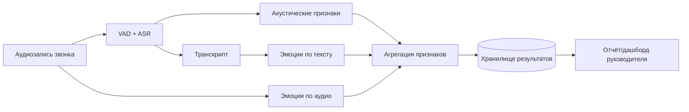

# Дизайн ML системы - Acoustic Stress & Emotion Monitor, MVP, v1

> Документ построен по шаблону [ML System Design Doc (Reliable ML)](https://github.com/IrinaGoloshchapova/ml_system_design_doc_ru/blob/main/ML_System_Design_Doc_Template.md).
>
> **Примечание о характере проекта.** Задача вдохновлена реальным
> классом прикладных систем (мониторинг психоэмоционального состояния
> сотрудников по аудиозаписям рабочих звонков), проект сейчас разрабатывается
> для реального заказчика и готовится к пилотированию.
>
> Название организации-заказчика, конкретные проприетарные
> модели, алгоритм интегральной оценка и проприетарные датасеты реальной
> системы защищены NDA и недоступны - в этом документе и в коде они
> заменены на нейтральные формулировки, открытые аналоги и
> baseline-заглушки (константы/простые эвристики) с явной пометкой
> каждого такого места.

## 1. Цели и предпосылки

### 1.1 Зачем идём в разработку продукта?

- **Бизнес-цель (PO).** Дать руководителю линии поддержки и HR
  систему поддержки принятия решений (СППР): инструмент раннего
  выявления повышенного стресса и выраженных негативных эмоций у
  сотрудников по записям их рабочих звонков, с отслеживанием динамики
  по каждому сотруднику во времени вместо разовой оценки одного
  звонка, чтобы вовремя скорректировать нагрузку, предложить
  короткий отдых или дополнительное обучение, не дожидаясь жалоб
  клиентов или явного снижения качества работы. Решение по сотруднику
  всегда принимает человек, система только даёт сигнал для внимания.
- **Почему ML улучшает ситуацию (PO и DS).** Прослушивание и ручная
  оценка всех звонков не масштабируется даже на небольшую команду.
  ML-модели позволяют автоматически извлекать акустические и
  текстовые признаки эмоционального состояния по каждому звонку и
  агрегировать их в компактный, сопоставимый между сотрудниками сигнал.
- **Критерии успеха итерации (PO).** Для тестового набора звонков
  пайплайн стабильно считает акустические признаки, эмоции по
  аудио/тексту и формирует агрегированный отчёт по звонку. На выборке
  с ручной экспертной разметкой агрегированная оценка качественно
  согласуется с отмеченными случаями явного стресса (без строгого
  количественного порога - он фиксируется на этапе пилота).

### 1.2 Бизнес-требования (БТ) и ограничения

- **БТ (кратко).** Нужен сервис, который по аудиозаписи рабочего
  диалога сотрудника определяет уровень эмоционального напряжения,
  сохраняет историю оценок по сотруднику для отслеживания динамики и последующего обзора
  руководителем.
- **Бизнес-ограничения (PO).**
  - Обрабатываются персональные данные (голос и речь сотрудников) -
    необходимы ограничения доступа и хранение в соответствии с
    политиками компании по работе с ПДн.
  - Часть production-моделей и финальная интегральная метрика риска
    принадлежат заказчику и защищены NDA - в этой учебной итерации
    недоступны, заменяются задокументированными заглушками.
  - Нельзя ссылаться на конкретную организацию, продукты, бренды и
    приватные датасеты - документ должен оставаться воспроизводимым
    без привязки к конкретному заказчику.
- **Ожидаемый результат итерации.** Рабочий baseline-пайплайн на
  открытых/синтетических данных, воспроизводящий архитектуру
  прод-класса систем такого рода, с явно размеченными точками, где
  реальная система использует закрытые модели.
- **Бизнес-процесс пилота (как модель встраивается).** После звонка
  запись асинхронно обрабатывается пайплайном; агрегированная оценка
  попадает в кабинет руководителя как часть ежедневной/еженедельной
  сводки по сотруднику - не как мгновенное решение, а как сигнал для
  внимания.
- **Критерии успешного пилота и пути развития.** Пилот считается
  успешным, если агрегированная оценка заметно (качественно и по
  ранжированию) согласуется с независимой экспертной оценкой на
  контрольной выборке звонков. Дальнейшее развитие: переход от
  baseline-эвристики агрегации к обучаемой модели, real-time
  уведомления.

### 1.3 Скоуп проекта или итерации

- **Входит в скоуп (DS).**
  - Распознавание речи (ASR) по аудиозаписи звонка.
  - Акустические признаки: тон, темп речи, паузы, и пр.
  - Эмоции по аудиоканалу (классификация по базовым эмоциональным
    классам).
  - Эмоции по тексту транскрипта.
  - Baseline-агрегация признаков в единую оценку эмоционального
    состояния звонка.
  - Сохранение результатов по звонку и по сотруднику для дальнейшего
    обзора.
  - Отслеживание динамики оценок по сотруднику во времени (тренд по
    истории звонков) вместо разовой оценки одного звонка.
- **Не входит в скоуп.**
  - Точная интегральная оценка эмоционального риска, используемая в
    реальной прод-системе (закрыта NDA) - замещена простой baseline-
    эвристикой с явной пометкой.
  - Автоматическое принятие кадровых решений: система - СППР
    (система поддержки принятия решений) для руководителя/HR, а не
    инструмент, который сам решает судьбу сотрудника.
  - Real-time обработка (в MVP - асинхронный батч/near-real-time).
  - Полноценный production-деплой (CI/CD, автоскейлинг, SLA).
- **Качество кода и воспроизводимость (DS).** Репозиторий настроен с
  ruff (lint + format) и pre-commit; структура проекта и зависимости
  фиксируются по мере добавления кода в следующих итерациях.
- **Технический долг, оставляемый для продуктивизации (DS).**
  - Baseline-агрегация вместо обученной интегральной модели.
  - Отсутствие нагрузочного тестирования и полноценного мониторинга.
  - Нет автоматизированного переобучения моделей на новых данных.
  - Не проработаны safety-ограничения на обработку длинных/шумных
    записей.

### 1.4 Предпосылки решения

- **Данные.** Аудиозаписи рабочих диалогов сотрудников (реальные
  записи заказчика недоступны; для MVP используются открытые
  датасеты эмоциональной речи и/или синтетические примеры).
- **Горизонт.** Оценка строится на уровне одного звонка; агрегация по
  сотруднику - на горизонте дня/недели, с накоплением истории для
  отслеживания динамики на более длинных периодах (месяц и дольше).
- **Гранулярность.** Единица хранения - один звонок: набор
  акустических признаков, эмоциональных оценок по аудио- и
  текстовому каналу и итоговая (baseline) оценка.
- **Частота пересчёта.** Модели пересчитываются по мере поступления
  новых звонков (событийно), переобучение моделей в скоуп текущей
  итерации не входит.

---

## 2. Методология

### 2.1 Постановка задачи

Многоканальная задача, объединяющая несколько подзадач:

1. **ASR** - распознавание речи (audio → text).
2. **Извлечение акустических признаков** - регрессия/эвристический
   расчёт характеристик голоса (тон, темп, паузы и пр.).
3. **Классификация эмоций по аудио** - классификация по базовому
   набору эмоциональных классов + оценка в пространстве
   валентность/активация/доминирование (VAD).
4. **Классификация эмоций по тексту** - классификация эмоций по
   транскрипту.
5. **Агрегация** - свёртка признаков всех каналов в единую оценку
   эмоционального состояния звонка (в MVP - baseline-правило на
   открытых признаках.

### 2.2 Блок-схема решения

Архитектура одинакова для бейзлайна и MVP - MVP отличается от
бейзлайна точкой агрегации (п. 5), которая в проде заменена на
закрытую модель:

### 2.3 Этапы решения задачи

**Этап 1 - подготовка данных.**

| Сущность | Есть в открытом доступе | Нужные роли | Проверка качества |
|---|---|---|---|
| Аудиозапись звонка | открытые датасеты эмоциональной речи (для MVP) | DS | проверка длительности, частоты дискретизации, наличия речи (VAD) |
| Транскрипт | получается через ASR | DS | ручная выборочная проверка качества распознавания |
| Метаданные (анонимный ID сотрудника, таймстемп) | синтетические для MVP | DS | проверка уникальности и полноты |

Результат этапа: воспроизводимый набор тестовых звонков с
метаданными для последующих этапов.

**Этап 2 - акустические признаки.**
- Выборки: кросс-валидация на уровне записи (не разбивать один звонок
  между train/test).
- Целевая переменная: количественные акустические характеристики
  (тон, темп, доля пауз) - не категориальная цель,
  скорее сигнальные признаки.
- Метрики: устойчивость и физическая адекватность признаков
  (сопоставление с ожидаемыми диапазонами), а не отдельная
  ML-метрика качества.
- Риски: шумные записи и короткие реплики дают нестабильные оценки -
  план: QC-статусы вместо принудительных нулевых значений.

**Этап 3 - эмоции по аудио и тексту.**
- Целевая переменная: класс эмоции (согласованный с бизнесом базовый
  набор: нейтраль/радость/грусть/злость/страх/отвращение/удивление)
  плюс непрерывные валентность/активация.
- Метрики: accuracy/F1 по классам на открытом валидационном наборе;
  связь с бизнес-результатом - через корреляцию с экспертной оценкой
  на этапе пилота.
- Риски: доменный сдвиг между открытыми датасетами обучения и
  реальной речью в рабочих звонках - явно фиксируется как
  ограничение MVP.

**Этап 4 - агрегация (baseline).**
- Простое взвешенное правило по нормализованным признакам,
  задокументированное в коде как явная заглушка `# NDA: заглушка
  вместо проприетарной интегральной модели`.
- Необходимый результат: единая оценка на звонок, сопоставимая между
  сотрудниками и периодами.
- Бизнес-проверка: эксперт просматривает выборку звонков с высокой и
  низкой агрегированной оценкой и подтверждает/опровергает адекватность
  ранжирования (PO и DS).

---

## 3. Подготовка пилота

### 3.1 Способ оценки пилота

Пилот предполагает сравнение агрегированной оценки системы с
независимой экспертной оценкой на контрольной выборке звонков
(PO определяет состав экспертной группы, DS готовит выборку и
сопоставление).

### 3.2 Что считаем успешным пилотом

Формализованный порог согласия (например, ранговая корреляция с
экспертной оценкой выше согласованного с бизнесом значения)
фиксируется отдельно перед запуском пилота - в текущей учебной
итерации не определяется.

### 3.3 Подготовка пилота

Baseline-пайплайн рассчитан на CPU-инференс без GPU-зависимостей;
ожидаемая вычислительная сложность - секунды на минуту аудио на
один звонок. Ограничение на сложность моделей в MVP: только
предобученные открытые модели, возможно дообучение на открытых данных.

---

## 4. Внедрение

> Раздел описывает возможную production-архитектуру на основе
> MVP-дизайна; реального деплоя в текущей итерации не планируется.

### 4.1 Архитектура решения

Сервисный пайплайн из независимых шагов, общающихся через очередь
сообщений: приём аудио → ASR → параллельно акустические признаки и
эмоции по аудио/тексту → агрегация → сохранение результата →
API для дашборда руководителя.

### 4.2 Инфраструктура и масштабируемость

Для MVP достаточно контейнеризации (docker-compose). Полноценный
оркестратор (например, Kubernetes) избыточен на этом масштабе и
может быть добавлен в продовой итерации при росте нагрузки/числа сервисов.

### 4.3 Требования к работе системы

Near-real-time, а не строгий real-time: допустима обработка звонка в
течение нескольких минут после его завершения. Пропускная способность
определяется числом параллельных рабочих звонков в организации
(в MVP не нормируется).

### 4.4 Безопасность системы

Внутренние сервисы не должны быть доступны извне без аутентификации.
Секреты и ключи доступа не хранятся в репозитории.

### 4.5 Безопасность данных

Голосовые записи и транскрипты - персональные данные: необходимо
ограничение доступа по ролям, минимизация хранимых метаданных
(анонимизированный идентификатор сотрудника вместо ФИО) и соответствие
применимым требованиям по защите персональных данных.

### 4.6 Издержки

Ориентировочно низкие на масштабе MVP: CPU-инференс предобученных
открытых моделей, без необходимости в GPU-кластере.

### 4.7 Integration points

Межсервисное взаимодействие - через очередь сообщений (publish/
subscribe); дашборд руководителя получает агрегированные данные через
отдельный read-only API.

### 4.8 Риски

- Качество ASR и акустических признаков деградирует на шумных или
  очень коротких записях.
- Эмоциональные модели, обученные на открытых датасетах, могут быть
  смещены относительно реальной рабочей речи.
- Не все открытые данные подходят для дообучения - есть датасеты с
  игрой актеров, в данном кейсе низкоэмоциональная речь операторов.
- Baseline-агрегация - временное решение; при неудачной бизнес-
  проверке потребуется пересмотр логики агрегации до пилота.
